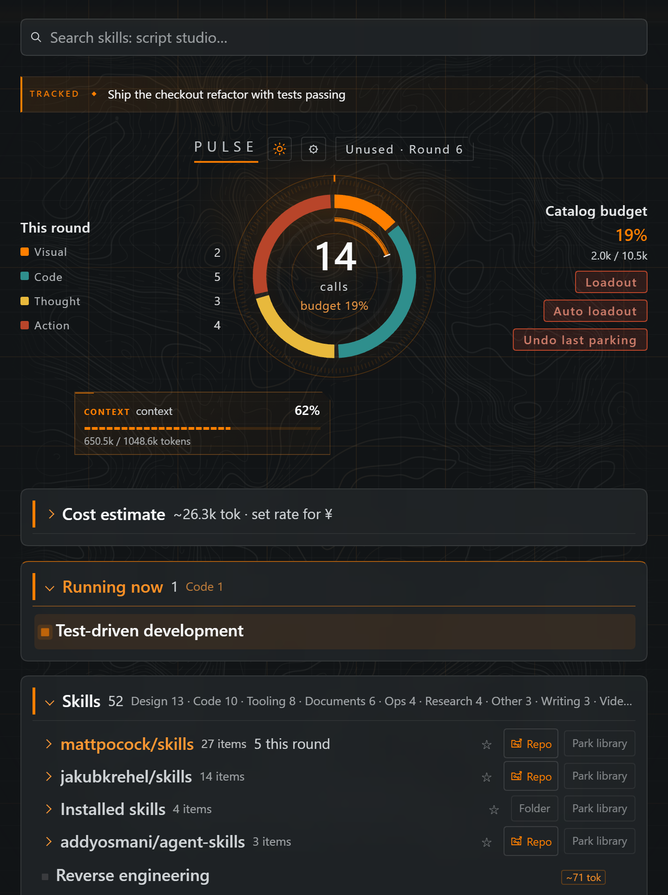
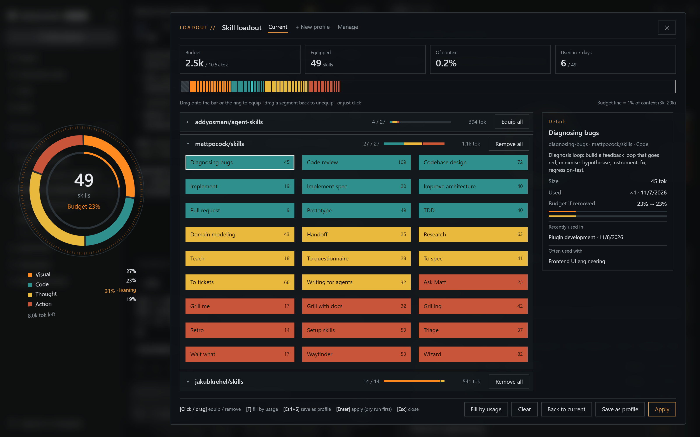
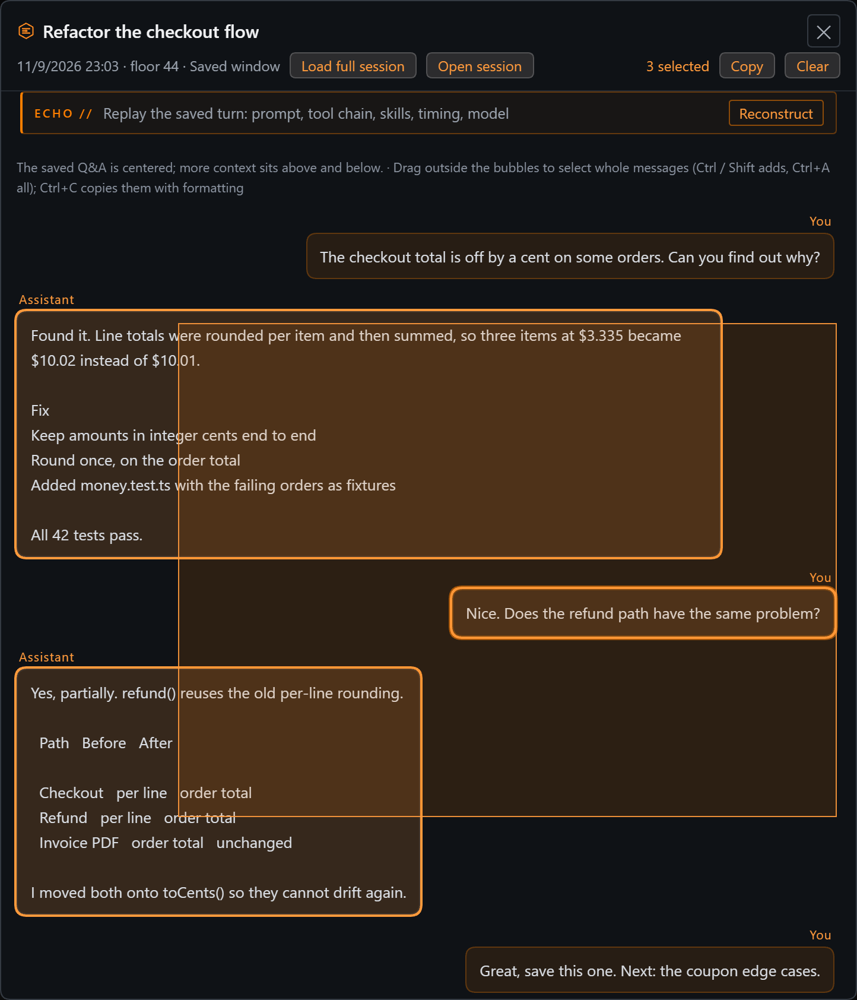
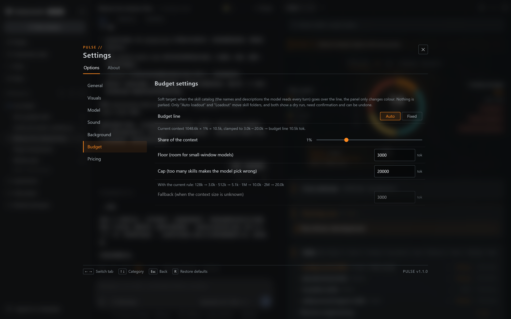

# PULSE · DSH Running Panel

[中文](./README.md)

A running panel for [DeepSeek Harness](https://deepseek-harness.github.io/deepseek-harness/en/guide/quickstart) (DSH): see which skills and tools this session actually loaded and where the prompt budget goes — plus a goals-and-ideas layer that keeps you on the current task without losing the other directions that come up along the way.

DSH injects a catalog of skills and tool schemas into every turn, and it is invisible: what this session loaded, how big the catalog is, what happens when you park a skill. PULSE shows it, and turns the dangerous part — parking, which moves files — into dry run, confirm, undo.

<p align="center"></p>

## Features

**Activity and budget**
- **Session ring** (right sidebar, `PULSE` tab): this turn's calls by category (visual / code / thought / ops), budget ring, catalog size, estimated tokens. Idle: a soft heartbeat in the centre. Working: a bright arc sweeps around; it "ignites" when work starts and fades out when it ends.
- **Skill loadout**: a full-screen loadout window over a blurred backdrop. Skills are grouped by library, collapsed until opened, with equip all / remove all per library. A tilted ring on the left shows whether the loadout leans visual / code / thinking / ops; a budget bar on top has one segment per skill, as wide as its tokens (built-ins are a locked hatched block, the vertical line is the budget line); skill tiles below (filled with their category color when equipped) — click, or drag onto the bar / ring to equip, drag back to remove. The detail column shows the budget share before / after, uses, recent conversations and frequent companions. Keys: F fill by usage, Ctrl+S save as profile, Enter apply (dry run first), Esc close. Skills another conversation is using cannot be removed.
- **Budget line follows the model**: by default 1% of the current model's context window (3k–20k); the share, floor and cap are adjustable in settings, which also shows the result for a few window sizes. A skill's own cost is fixed, so a larger-window model moves the line right. With no conversation reporting a window the last one seen is used, and only then the fallback. It is a soft target: going over only changes colour, nothing is parked. Settings can switch to a fixed value.
- **Auto loadout** (formerly "Budget plan"): dry run first (keep set = pinned skills / libraries + used in the last 7 days), confirm in a two-column dialog, apply; undoable, and undo records survive restarts. Nothing is ever parked silently.
- **Skill profiles**: save which skills are enabled per kind of work (coding / video / writing…) and switch in one go — dry run, confirm, undoable. Newly installed skills and skills another conversation is using are never parked by a switch.
- **Cross-conversation guard**: skills another open conversation is using are kept by the budget plan; parking one by hand first tells you which conversation it would affect (it could no longer call the skill, and the skill's own files would be missing).
- **Cold layer**: parked skills stay visible as an index; restore one or a whole library.
- **Install-batch groups, search, most used, context menu** (insert, rename, edit description, open folder, pin, park).
- **Corner ring** in the conversation header: click to open the panel.



**Goals and ideas**
- **Goal bar** (one row above the ring): a running DSH `/goal` takes it (read-only, with phase and round segments); otherwise the workspace's own goal. Click for the drawer: confirm, done, edit, new goal, remove, history.
- **Focus mode** (off by default): skills, tools and groups not used since the goal started are dimmed.
- **Ideas & branches**: the assistant's "next you could…" lists and your own "later" are collected per workspace into the goal drawer. Make one the goal, mark it done, dismiss it, or "↗" jump back to the message it came from. An idea made into the goal follows it (done when the goal is done); ideas done along the way are flagged "maybe done" by the model and count only once you confirm. Past sessions of the project can be collected in one go (with an estimate of model calls first).
- **Goal proposals**: with no goal, the newest open idea is proposed; with no ideas, the model can infer one from the last few turns. Nothing counts until you click "use as goal".

**ECHO (saved excerpts)**
- Save any answer with 10 floors before and 5 after; a cross-session library with search and jump back.
- **Scene reconstruction**: replay the saved turn — prompt, duration, steps, tool count, model, tokens, skills loaded, a tool time track (failures in red), slowest tools. Tool arguments and results are never read.
- **Box-select and copy**: drag outside the bubbles to select whole messages (Ctrl / Shift adds, Ctrl+A all, Esc clears); Ctrl+C copies them with formatting — raw Markdown with role headers as plain text plus HTML, so Word / Notion keep headings, lists, tables and code. A text selection spanning two or more bubbles copies them whole too.
- **Suggested favorites**: turns you praised, that delivered files, recovered from errors or were big (up to three, saved only when you click).
- **Archive search**, including closed sessions.

<p align="center"></p>

**Other**
- **Auto-translation of new skills**: fills missing Chinese names/descriptions of newly installed skills and plugin tools with your default model (gaps only; your edits are never overwritten).
- **Look**: follows DSH light/dark; contour backdrop and tactical grid; a mosaic reveal the first time the sidebar opens after DSH starts; all motion honours reduced motion and performance mode.
- **Sound effects** (off by default): click, expand, collapse, open, done, start working — synthesized live with Web Audio, no audio files.
- **Version check**: if the panel and the plugin host running inside DSH disagree, a banner tells you to quit DSH completely and reopen it.



## Privacy and model calls

**Nothing is uploaded by default.** The panel only uses local DSH routes (`/dsh-running-panel/*`); data lives in `$DSH_HOME/running-panel/` (default `~/.dsh/running-panel/`):

| File | Contents |
|---|---|
| `usage.json` | call counts and times (no conversation text) |
| `echoes.json` | excerpts you saved, workspace goals |
| `ideas.json` | ideas & branches (text, source session and message ids) |
| `catalog-overlay.json` | display names / descriptions (machine translations are marked) |
| `undo.json` | undo records for parking |
| `skill-profiles.json` | skill profiles (name, skills, pinned libraries) and the last switch |

**Background model calls need your consent.** These three send content through DSH's model service to the default model you picked in DSH (i.e. your configured provider); each is one short request and uses your account's tokens:

- **Auto-translation**: names and descriptions of new skills / tools.
- **Goal suggestion**: the last few turns of the session (up to ~3000 characters), only when there is no goal.
- **Idea collection**: turns whose answer ends with a "next steps / could also" list, or where you said "later / not now" (keyword prefilter; most turns make no call).

The first time you open the panel, a card at the top explains this; none of the three runs automatically until you choose "Enable", and the master switch and each feature can be turned off in settings at any time. Buttons you press yourself ("translate now", "check what got done", "collect from past sessions") are explicit and call directly.

Parking moves directories between the shared `~/.agents/skills` and `~/.agents/skills-parked`; other apps using that root are affected.

## Install

> Developed and verified against **DSH desktop `0.2.1-rc.5` / `0.2.2-rc.1`**; standalone development needs **Node `22.23.4` or newer** (`node:sqlite`, zstd). The plugin uses DSH service and event APIs, some of which (goal projection, model service, session log format) are undocumented; a DSH update may break individual features, which the panel tries to degrade quietly.

1. Extract the source release into a stable directory.
2. Register it in a DSH profile, e.g. `~/.dsh/profiles/desktop/package.json`:

   ```jsonc
   {
     "dependencies": {
       "@local/dsh-running-panel": "link:/absolute/path/to/dsh-running-panel"
     },
     "dsh": {
       "profile": {
         "bundles": [
           /* keep your existing bundles */
           "@local/dsh-running-panel"
         ]
       }
     }
   }
   ```

   On Windows use forward slashes in the link path (`link:H:/tools/dsh-running-panel`).

3. Install and **fully restart** DSH:

   ```bash
   cd ~/.dsh/profiles/desktop
   pnpm install
   ```

   The host half loads only when the DSH process starts: closing the window to the tray is not enough — quit from the tray icon and reopen. The client half updates on page refresh; the panel warns when the two disagree.

## Usage

- Open the **PULSE** tab in the right sidebar, or click the corner ring.
- **Goal bar**: open the drawer for goals and ideas; focus mode is in settings.
- **Skill loadout**: compose, then **Apply** shows a dry run; files move only after confirming.
- **Auto loadout**: dry run; files move only on **Apply**; **Undo** reverts the last plan.
- **Skill rows**: hover for actions, right-click for the full menu; `↪` inserts a skill reference through DSH's slash menu.
- **Settings** (gear): model-call consent and per-feature switches, focus mode, theme, motion, sound, budget target, pricing. The version is shown in the bottom-right corner.

## Known limitations

- **Token numbers are estimates**, not a bill: Host tokenMeter when available, otherwise `chars / 4`, labelled.
- **Session identity is fuzzy across forks**: a forked or resumed tab may report a different session id; counters follow the tab and can read zero.
- **Depends on DSH internals** (see above): `session/event`, `tools/result`, `skills`, `sessionSkillCatalog`, `llm`, `agentDefaultModel`, the session `goal` projection, multi-frame zstd session logs.
- **Observation starts with the plugin**: earlier calls are not counted; use of the shared skills root by other apps is invisible.
- **Storage faults are visible**: damaged or unreadable stores are preserved, never overwritten, and reported in the panel.
- **Jump back** locates messages through DSH's chat projection, loading at most 12 older pages within 20 seconds; removed messages or very long histories report failure.
- **Idea extraction and goal inference are only as good as your model**; everything is a proposal you confirm — the model never writes a goal or marks an idea done on its own.

## Development

```bash
npm test                         # node:test: unit tests, real host routes in a child process, client with a fake React
node tools/build-client.mjs      # regenerate client.js after editing client/NN-*.js
```

```
index.js            host: routes, stores, budget plan, park/restore, background model tasks
client/NN-*.js      client source fragments, concatenated in file-name order into client.js (no bundler)
client.js           generated; DSH loads it directly (the build stamps the version)
goal-core.js        goals (pure)          idea-core.js       ideas & branches (pure)
echo-core.js        Echo favorites (pure) scene-core.js      scene reconstruction (pure)
suggest-core.js     suggested favorites   translate-core.js  auto-translation (pure)
session-store.js    session disk probe, multi-frame log decoding
catalog.js          built-in names / tags / libraries / sources
studio.html         contour studio (backdrop editor; all graphics generated)
tests/              node:test; test-support/ holds the child host and fake services
```

When releasing: bump `package.json` first, then run `node tools/build-client.mjs` (`tests/build.test.mjs` checks they match).

## Localization

Everything localizable is plain data, no build step:

| Layer | Where | Notes |
|---|---|---|
| UI copy | `zh` / `en` objects in `client/00-header-i18n.js` | key sets must match (`tests/tooltip.test.mjs`) |
| Capability names, tags, libraries | `catalog.js` | rows `[id, 中文, English, tag]` |
| Hover one-liners | `SHORT_DESCS` / `TOOL_TIPS` | Chinese only; the English UI shows the capability's own description |
| Capabilities installed later | `~/.dsh/running-panel/catalog-overlay.json` | per key (`skill:<id>` / `tool:<id>`) `{ zh, en }`; auto-translation writes here too |

## Acknowledgements

The look and motion are inspired by the interface of Tom Clancy's The Division. The project contains no assets, images or audio from the game, is not affiliated with Ubisoft, and all trademarks belong to their owners.

## License

MIT, see [LICENSE](./LICENSE).
