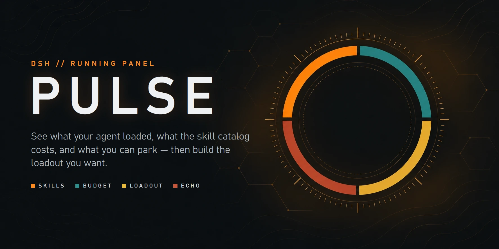
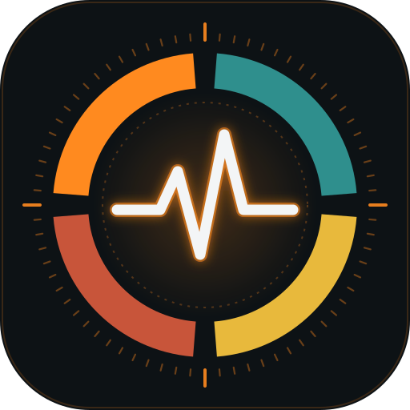
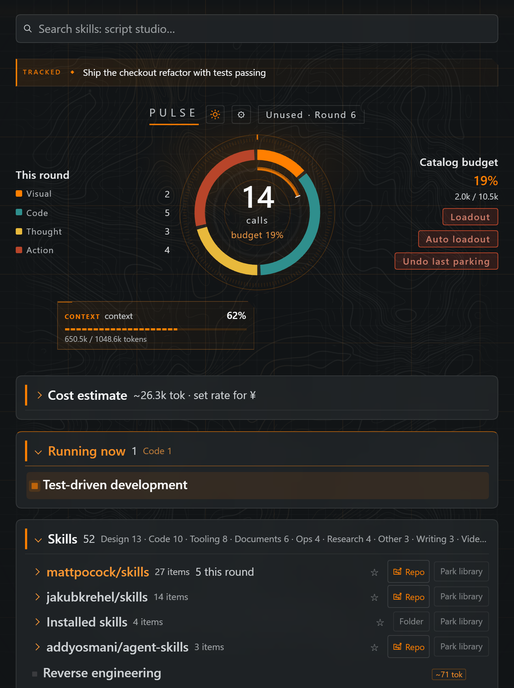
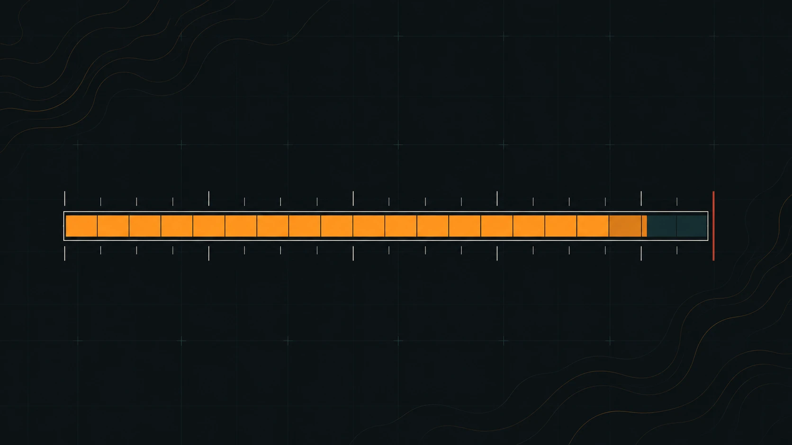
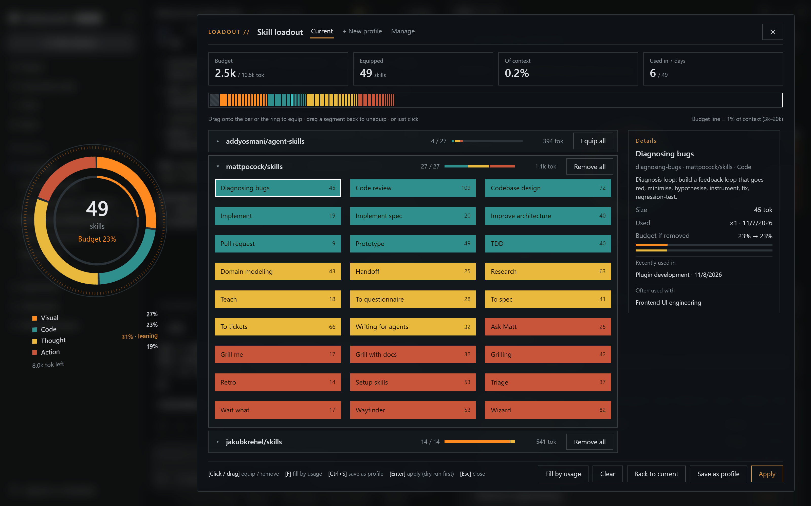
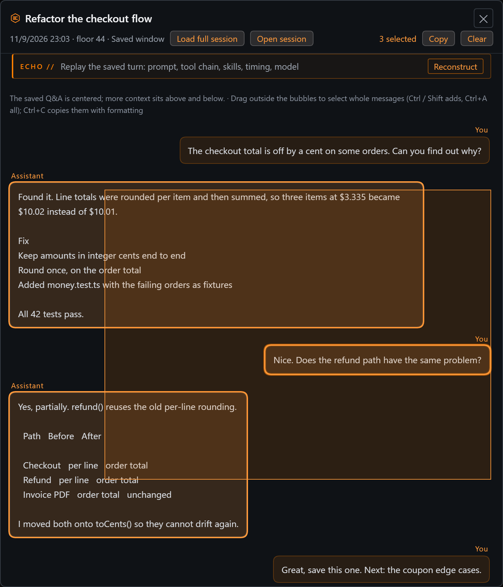
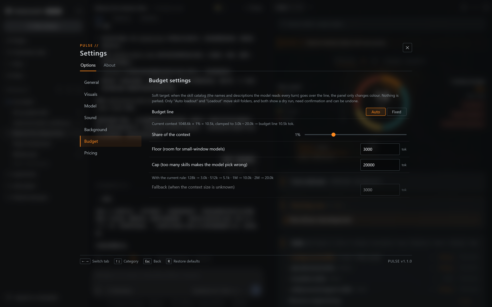
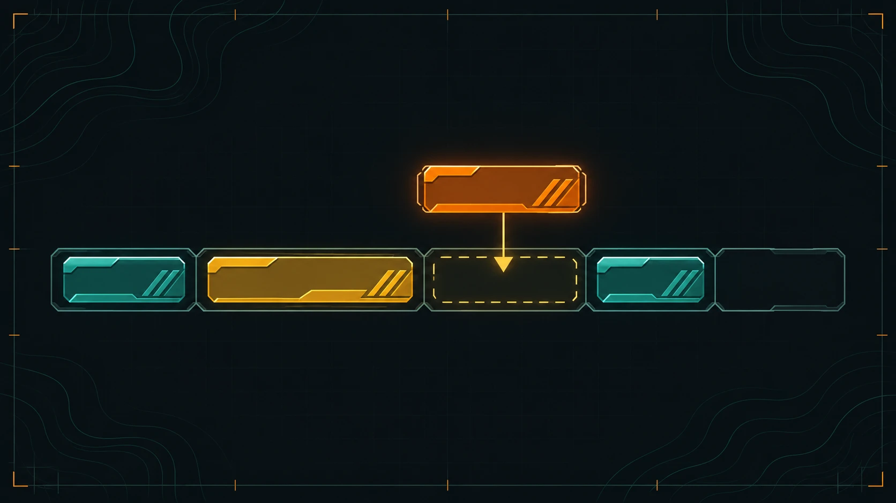

<p align="center"></p>

#  PULSE · DSH 运行面板

[English](./README.en.md)

给 [DeepSeek Harness](https://deepseek-harness.github.io/deepseek-harness/en/guide/quickstart)（DSH）用的运行面板：看清这个会话实际加载了哪些技能和工具、提示词预算花在哪里；再加一层「目标与灵感」，让你专注当下这件事，同时不丢掉路上冒出来的其它方向。

DSH 每一轮都会把技能目录和工具清单塞进提示词，但你看不到：这个会话到底加载了什么、目录有多大、停用一个技能会怎样。PULSE 把这些画出来，并把危险的那一步——停用技能（会移动文件）——做成「先预演、再确认、可撤销」。

<p align="center"></p>

<sub>截图为英文界面，中文界面布局相同。</sub>

## 功能

<p align="center"></p>

**运行与预算**
- **会话圆盘**（右侧栏 `PULSE` 标签）：本轮按类别（视觉 / 代码 / 思考 / 行动）的调用、预算环、目录体积、估算 token。闲置时圆心轻轻心跳；agent 工作时一道亮弧绕圈扫描；开始工作时「点燃」一下，结束后余辉慢慢褪去。
- **技能装配**：全屏装配窗口，背景虚化。技能按库分组、默认收起，点开才是具体技能，库头可一键全装 / 全卸。左侧倾斜的圆盘显示这套配装偏向视觉 / 编码 / 思考 / 执行哪一类；右侧上方是预算条，每段宽度就是那个技能占的 token，内置技能是锁定的斜纹段，竖线是预算线；下方是技能（装上的磁贴填类别色），点击或拖到预算条 / 圆盘上装上，拖回来卸下。详情栏显示装上前后的占比、用过几次、最近用在哪些对话、常和谁一起用。快捷键：F 按常用补满、Ctrl+S 存为配置、Enter 应用（先预演）、Esc 关闭。别的对话正在用的技能卸不下。
- **预算线随模型变化**：默认取当前模型上下文窗口的 1%（下限 3k、上限 20k），比例、下限、上限都能在设置里改，并显示代入几档窗口的结果；技能本身的占用是固定的，换更大窗口的模型时预算线自动右移。没有会话上报窗口时按上次见到的算，都没有才用后备值。它只是软目标，超了只变色提示，不会停用技能。设置里也可改为固定值。
- **自动配装**（原「预算方案」）：先预演（保留集 = 钉住的技能 / 库 + 最近 7 天用过的），在双栏对话框里确认，再应用；可以撤销，撤销记录重启后仍在。绝不静默停用。
- **技能配置**：按工作类型（写代码 / 剪视频 / 写短剧…）保存「启用哪些技能」，一键切换；同样先预演、确认才动文件、可撤销。新装的技能和别的对话正在用的技能不会被切换停掉。
- **跨对话保护**：别的打开着的对话正在用的技能，预算方案自动保留；手动停用时先提醒你会影响哪个对话（停用后那边调不到它，技能自带的文件也会找不到）。
- **冷层**：停用的技能仍以索引形式可见，可以单个或整库恢复。
- **安装批次分组、搜索、历史常用、右键菜单**（插入、改名、改说明、打开目录、钉住、停用）。
- **对话右上角小圆盘**：点一下打开面板。



**目标与灵感**
- **目标条**（圆盘上方一行）：正在运行的 DSH `/goal` 优先显示（只读，带阶段和分段轮数）；否则显示这个工作区自己的目标。点开是抽屉：确认、完成、改写、换个目标、移除，以及历史。
- **专注模式**（默认关）：目标开始后没用过的技能、工具和分组变淡。
- **灵感与分支**：开发路上助手列出的「下一步可以…」、你说的「以后再做」，按工作区自动收进目标抽屉。每条可以设为目标、标完成、忽略，或「↗」跳回当初提出它的那条消息。设为目标的灵感跟着目标走（目标完成时它也完成）；别处顺手做掉的，模型会标「可能已完成」，等你确认。可以从这个项目的历史会话里一次性整理（先告诉你要调几次模型）。
- **目标提议**：没有目标时，最新一条待做灵感作为提议；没有灵感时，可以让模型从最近几轮对话推断一个。都要你点「设为目标」才算数。

<p align="center"></p>

**ECHO（对话收藏）**
- 在任意回答上收藏，保存锚点前 10 楼、后 5 楼；跨会话的回声库，可以搜索、跳回原会话。
- **现场重建**：打开一条 Echo，还原收藏那一轮——触发指令、用时、步数、工具次数、模型、token、加载的技能、工具时间轨道（失败标红）、最耗时的工具。不读工具参数和结果正文。
- **框选复制**：在气泡外按住左键拖动画框，框到的消息整条选中（Ctrl / Shift 加选，Ctrl+A 全选，Esc 取消），Ctrl+C 按原格式复制：纯文本是带「用户 / 助手」标头的原始 Markdown，同时附带 HTML，粘进 Word / Notion 保留标题、列表、表格和代码块。气泡里选文字跨了两条以上，也按整条复制。
- **建议收藏**：根据你的肯定、交付了文件、出错后修好、大回合，提议值得收藏的回合（最多 3 条，点了才收藏）。
- **全库搜索**：包括已关闭的旧会话。

<p align="center"></p>

**其它**
- **新技能自动翻译**：新装的技能 / 插件工具缺中文名或说明时，用你的默认模型补上（只补缺，手改过的不动）。
- **外观**：跟随 DSH 明暗主题；等高线底图、战术网格；每次启动后第一次打开侧栏有一段马赛克显现；所有动效遵守「减少动态效果」和性能模式。
- **音效**（默认关）：点击、展开、收起、打开、完成、开始工作；全部由 Web Audio 现场合成，不含任何音频文件。
- **版本检查**：界面和 DSH 里运行的插件 Host 版本对不上时，面板顶部会提示你完全退出 DSH 再打开。



## 隐私与模型调用

**默认什么都不上传。** 面板只走本机的 DSH 路由（`/dsh-running-panel/*`），数据存在 `$DSH_HOME/running-panel/`（默认 `~/.dsh/running-panel/`）：

| 文件 | 内容 |
|---|---|
| `usage.json` | 调用次数和时间（不含对话内容） |
| `echoes.json` | 你主动收藏的对话片段、工作区目标 |
| `ideas.json` | 灵感与分支（文字、来源会话和消息 id） |
| `catalog-overlay.json` | 显示名 / 说明（含自动翻译的结果，标注为机翻） |
| `undo.json` | 停用操作的撤销记录 |
| `skill-profiles.json` | 技能配置（名称、技能清单、钉住的库）和上一次切换 |

**后台模型调用需要你同意。** 下面三项会通过 DSH 的模型服务把内容发给你在 DSH 里选的默认模型（也就是你配置的服务商），每次是一次短请求，会消耗你账户的 token：

- **自动翻译**：新技能 / 工具的名字和说明。
- **推断目标**：当前会话最近几轮对话（约 3000 字以内），只在没有目标时。
- **灵感收集**：回答末尾列出「下一步 / 还可以」并带列表、或你说了「以后 / 先不做」的回合（关键词预筛，大多数回合不会调用）。

第一次打开面板时顶部会出现一张说明卡，你选「开启」之前这三项都不会自动运行；之后随时可以在设置里关掉总开关或单项。你自己点的按钮（「现在翻译」「检查完成情况」「从历史会话整理」）属于明确操作，会直接调用。

停用技能会在共享的 `~/.agents/skills` 和 `~/.agents/skills-parked` 之间移动目录，其它使用这个目录的应用也会受影响。

## 安装

> 开发和验证用的是 **DSH 桌面版 `0.2.1-rc.5` / `0.2.2-rc.1`**，独立开发需要 **Node `22.23.4` 或更新**（用到 `node:sqlite` 和 zstd）。插件依赖 DSH 的服务和事件接口，其中一部分（目标投影、模型服务、会话日志格式）没有公开文档；DSH 升级后个别功能可能失效，面板会尽量安静地降级。

**一条命令安装。** 先从托盘图标完全退出 DSH（DSH 运行时命令行不允许改桌面版 profile），再从 npm 装进你用的 profile：桌面版用 `desktop`，`dsh web` 用 `web`：

```bash
dsh plugin --profile desktop add @xdeemoh/dsh-pulse
```

装好后重新打开 DSH。（Host 部分只在 DSH 进程启动时加载，以后每次更新同样要从托盘图标完全退出再打开，只关窗口不够。）以后更新用 `dsh plugin --profile desktop update @xdeemoh/dsh-pulse`，卸载用 `dsh plugin --profile desktop remove @xdeemoh/dsh-pulse`。

<details>
<summary>手动安装（用 Release 里的源码包或本地目录）</summary>

1. 把源码包解压到一个固定目录。
2. 在 DSH 的 profile 里注册，例如桌面版 `~/.dsh/profiles/desktop/package.json`：

   ```jsonc
   {
     "dependencies": {
       "@xdeemoh/dsh-pulse": "link:/absolute/path/to/dsh-running-panel"
     },
     "dsh": {
       "profile": {
         "bundles": [
           /* 保留原有的 bundles */
           "@xdeemoh/dsh-pulse"
         ]
       }
     }
   }
   ```

   Windows 上 link 路径用正斜杠（`link:H:/tools/dsh-running-panel`）。

3. 在 profile 目录运行 `pnpm install`（或 `dsh plugin --profile desktop install`），然后完全重启 DSH。

界面部分刷新页面即可更新；Host 和界面版本不一致时面板会提示。

</details>

## 使用

<p align="center"></p>

- 打开右侧栏的 **PULSE** 标签，或点对话右上角的小圆盘。
- **目标条**：点开抽屉管理目标和灵感；设置里可开专注模式。
- **技能装配**：拼好后按「应用」先预演，确认才移动文件。
- **自动配装**：先预演，点「应用」才会移动文件；「撤销」恢复上一次方案。
- **技能行**：悬停出现操作，右键有完整菜单；`↪` 通过 DSH 的斜杠菜单插入技能引用。
- **设置**（齿轮）：模型调用的总开关和单项、专注模式、主题、动效、音效、预算目标、价格等。设置窗口右下角显示当前版本。

## 已知限制

- **token 数是估算**，不是账单：优先用 Host 的 tokenMeter，否则按「字符 / 4」并标注来源。
- **会话身份在分叉时不稳定**：DSH 在分叉 / 恢复的标签页里可能报不同的会话 id，面板跟着标签页走，计数可能显示为 0。
- **依赖 DSH 内部接口**（见上）：`session/event`、`tools/result`、`skills`、`sessionSkillCatalog`、`llm`、`agentDefaultModel`、会话 `goal` 投影、多帧 zstd 会话日志。
- **观测从插件加载开始**：之前的调用不在计数里；共享技能目录被其它应用使用的情况看不到。
- **存储故障会显示出来**：已有文件损坏或读不了时保留原文件、不覆盖，并在面板里报错。
- **跳回原对话**通过 DSH 的会话投影定位消息，最多向上加载 12 页、20 秒；消息被删除或历史太长时会报告失败。
- **灵感提炼和目标推断的质量取决于你的模型**；提议都要你确认，模型不会擅自写入目标或把灵感标为完成。

## 开发

```bash
npm test                         # node:test，单元测试 + 子进程里跑真实路由的 Host 测试 + 假 React 的界面测试
node tools/build-client.mjs      # 改完 client/NN-*.js 片段后重新生成 client.js
```

```
index.js            Host：路由、存储、预算方案、停用 / 恢复、模型后台任务
client/NN-*.js      界面源码片段，按文件名顺序拼成 client.js（不打包、不转译）
client.js           生成物：DSH 直接加载它（构建时写入版本号）
goal-core.js        目标（纯函数）        idea-core.js       灵感与分支（纯函数）
echo-core.js        Echo 收藏（纯函数）   scene-core.js      现场重建（纯函数）
suggest-core.js     建议收藏（纯函数）    translate-core.js  自动翻译（纯函数）
session-store.js    会话磁盘探测、多帧日志解码
catalog.js          内置显示名 / 标签 / 库 / 源地址
studio.html         等高线工坊（背景编辑器，图形全部由程序生成）
tests/              node:test 测试；test-support/ 里是子进程 Host 和假服务
```

改版本时：先改 `package.json` 的版本号，再运行 `node tools/build-client.mjs`（`tests/build.test.mjs` 会检查两者一致）。

## 本地化

可本地化的内容都是纯数据，不需要构建：

| 层 | 位置 | 说明 |
|---|---|---|
| 界面文案 | `client/00-header-i18n.js` 里的 `zh` / `en` 对象 | 两边键必须一致（`tests/tooltip.test.mjs` 会检查） |
| 能力名称、标签、库 | `catalog.js` | 每行 `[id, 中文, English, tag]` |
| 悬停短说明 | `SHORT_DESCS` / `TOOL_TIPS` | 只有中文；英文界面显示能力自带的说明 |
| 之后安装的能力 | `~/.dsh/running-panel/catalog-overlay.json` | 按键（`skill:<id>` / `tool:<id>`）写 `{ zh, en }`；自动翻译也写在这里 |

## 致谢

**参与者**

- **XDeemo**（[@XDeemoH](https://github.com/XDeemoH)）：作者。设计方向、需求、真机试用和验收。
- **Claude**（Anthropic）：编码、测试、文档和截图。
- **GPT**（OpenAI）：README 横幅背景和分区插图。
- **DSH**（DeepSeek Harness 里的智能体）：早期版本开发、真机测试和审查。

视觉和动效受《全境封锁》（Tom Clancy's The Division）界面风格启发；项目不包含该游戏的任何素材、图像或音频，与育碧（Ubisoft）没有关联，相关商标归其所有者。

## 许可

MIT，见 [LICENSE](./LICENSE)。
